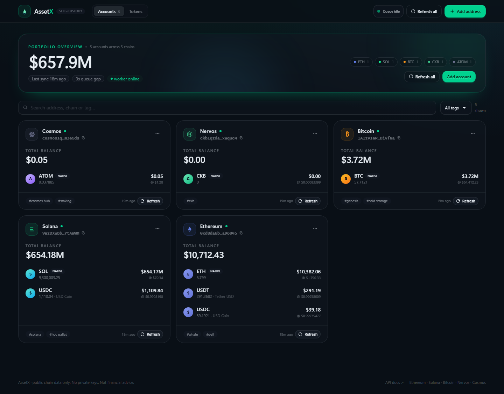

# AssetX

A private, multi-chain portfolio tracker for public wallet addresses. AssetX reads balances from public RPC endpoints, prices assets in USD, and stores everything locally in SQLite.



Supported chains: **Ethereum, Solana, Bitcoin, Nervos, Cosmos, Stacks**.

## Highlights

- **Account cards** on the home page, each showing up to three assets and a total USD balance.
- **Chain cards** that roll up total USD value, portfolio share, account count, and last sync per chain; click a card to filter the account grid.
- **Per-card refresh** plus a global **Refresh all** action.
- **Sequential refresh queue** with a 3 second gap between address starts to avoid public endpoint rate limits.
- **Public RPC failover**: every chain has multiple endpoints; the next endpoint is tried when one fails.
- **Token registry**: one token can have a different ERC-20 contract, SPL mint, Cosmos bank denom, or SIP-010 asset id on each chain.
- **Lido assets on Ethereum**: the registry seeds `stETH` and the Lido Earn ETH vault share token `earnETH` with their canonical contracts, so both are read and priced on every Ethereum refresh.
- **Uniswap V3 and V4 LP NFTs on Ethereum**: a wallet refresh also scans the canonical V3 `NonfungiblePositionManager`, discovers V4 position ids through a public Blockscout index, decodes each position's range and liquidity with concentrated-liquidity math, and prices the underlying tokens in USD.
- **Tags** on addresses, stored lowercase.
- **Manual price refresh** through DefiLlama with a CoinGecko fallback and a short cache.
- **SQLite persistence** for addresses, tags, token networks, balances, LP positions, cached prices, and refresh jobs.
- No wallet connection and no private keys. AssetX only reads public chain data.

## Tech stack

| Layer | Stack |
| --- | --- |
| Frontend | Bun, Vite, TypeScript, Vue 3, DaisyUI, Tailwind CSS |
| Backend | Python 3.11+, FastAPI, httpx, sqlite3 |
| Data | SQLite (WAL mode) |
| Prices | DefiLlama, CoinGecko fallback |
| Chain access | Public RPC / REST APIs with ordered failover |

## Quick start

Prerequisites: Python 3.11+ and [Bun](https://bun.sh/).

```powershell
# 1. Backend
python -m venv .venv
.\.venv\Scripts\python.exe -m pip install -r backend\requirements-dev.txt

# 2. Frontend dependencies
cd frontend
bun install
cd ..

# 3. Run the API (terminal 1)
cd backend
..\.venv\Scripts\python.exe -m uvicorn app.main:app --reload --port 8000

# 4. Run the Vite dev server (terminal 2)
cd frontend
bun run dev
```

Open <http://127.0.0.1:5173>. The Vite dev server proxies `/api` to the FastAPI server on port 8000.

For a single-server production-style run:

```powershell
cd frontend
bun run build
cd ..\backend
..\.venv\Scripts\python.exe -m uvicorn app.main:app --host 127.0.0.1 --port 8000
```

Open <http://127.0.0.1:8000>. FastAPI serves `frontend/dist` when it exists. API docs are at `/api/docs`.

## Configuration

Copy `backend/.env.example` to `backend/.env` to override defaults. Useful settings:

| Setting | Default | Purpose |
| --- | --- | --- |
| `ASSETX_DATABASE_PATH` | `backend/data/assetx.db` | SQLite file |
| `ASSETX_REFRESH_INTERVAL_SECONDS` | `3` | Minimum start-to-start gap between addresses |
| `ASSETX_PRICE_CACHE_SECONDS` | `15` | Price cache TTL for a batch |
| `ASSETX_REQUEST_TIMEOUT_SECONDS` | `20` | RPC HTTP timeout |
| `ASSETX_ETHEREUM_RPCS` | built-in list | Comma-separated RPC override |
| `ASSETX_ETHEREUM_LP_POSITIONS_ENABLED` | `true` | Scan Ethereum wallets for Uniswap LP NFTs |
| `ASSETX_ETHEREUM_LP_POSITION_MANAGERS` | built-in list | Comma-separated V3 position-manager override |
| `ASSETX_ETHEREUM_LP_MAX_POSITIONS` | `30` | Position scan cap per wallet |
| `ASSETX_ETHEREUM_LP_V4_ENABLED` | `true` | Scan for Uniswap V4 positions |
| `ASSETX_ETHEREUM_LP_BLOCKSCOUT_APIS` | built-in list | Comma-separated Blockscout API override |
| `ASSETX_SOLANA_RPCS` | built-in list | Comma-separated RPC override |
| `ASSETX_BITCOIN_APIS` | built-in list | Comma-separated API override |
| `ASSETX_NERVOS_RPCS` | built-in list | Comma-separated RPC override |
| `ASSETX_COSMOS_APIS` | built-in list | Comma-separated REST override |
| `ASSETX_STACKS_APIS` | built-in list | Comma-separated Hiro API override |

The defaults use only public endpoints. They are rate limited and can change without notice; use your own endpoints for heavier usage.

## Tests

```powershell
cd backend
..\.venv\Scripts\python.exe -m pytest -q
```

The suite covers address validation (including bech32/bech32m, c32check, and CKB lock decoding), token registry CRUD, queue deduplication, RPC failover, Uniswap V3/V4 LP position decoding and concentrated-liquidity math, Keccak-256, price caching, and the full refresh-to-balance workflow with deterministic fakes.

Frontend checks:

```powershell
cd frontend
bun run typecheck
bun run build
```

## Documentation

- [Documentation index](docs/README.md)
- [Architecture and data flow](docs/architecture.md)
- [API reference](docs/api.md)
- [Chains, RPCs and token support](docs/chains.md)
- [Development guide](docs/development.md)

## Known scope

- Ethereum: native ETH, ERC-20 balances (including the seeded Lido `stETH` and `earnETH`), and Uniswap V3/V4 LP NFT positions. `stETH` is rebasing, so a refresh snapshots the current balance plus accrued staking rewards; `earnETH` is a vault share token priced per share. Unclaimed Lido Earn shares, pending Lido Earn deposit/redeem queue requests, Uniswap V2 LP tokens (ERC-20), generic NFTs, and staked positions held by other contracts are out of scope. V4 token ids are discovered through a public Blockscout NFT index before the position is read on-chain. Uncollected LP fees are not included in the position value.
- Solana: native SOL and SPL token accounts, no stake accounts.
- Bitcoin: native BTC only. BRC-20, Runes and inscription indexers are out of scope.
- Nervos: native CKB only. Generic UDT tracking is out of scope.
- Cosmos: Cosmos Hub native ATOM and Cosmos SDK bank denoms. Staked balances are not included.
- Stacks: native STX and SIP-010 fungible tokens, including seeded sBTC. NFTs and contract-principal accounts are out of scope. Stacked STX that remains in the wallet is included in the on-chain balance.
- Prices come from third-party public APIs. Tokens without a CoinGecko id are tracked but shown as unpriced. LP underlying tokens are priced by contract address, so an obscure token without a DefiLlama or CoinGecko price makes the position unpriced.
- The refresh worker is in-process. A running job is marked failed on restart; queued jobs are requeued.

## License

MIT. See [LICENSE](LICENSE).
