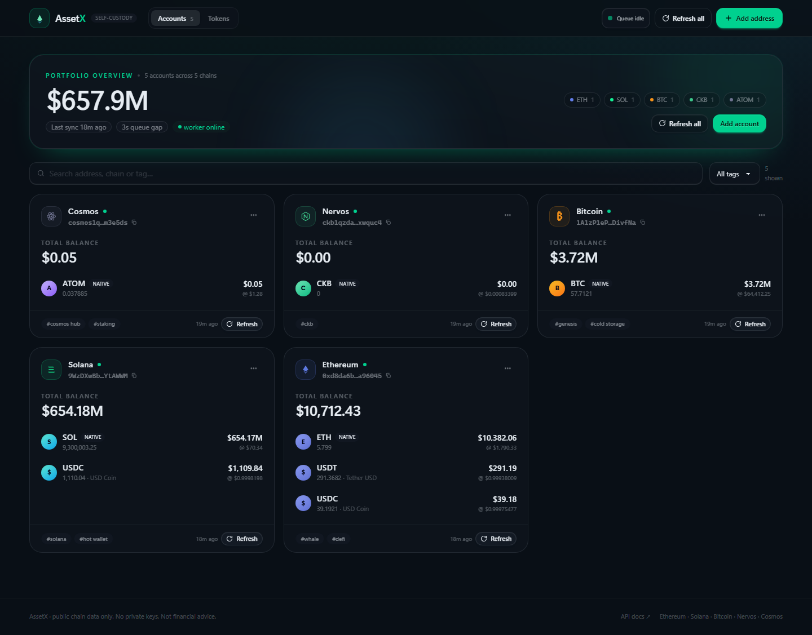
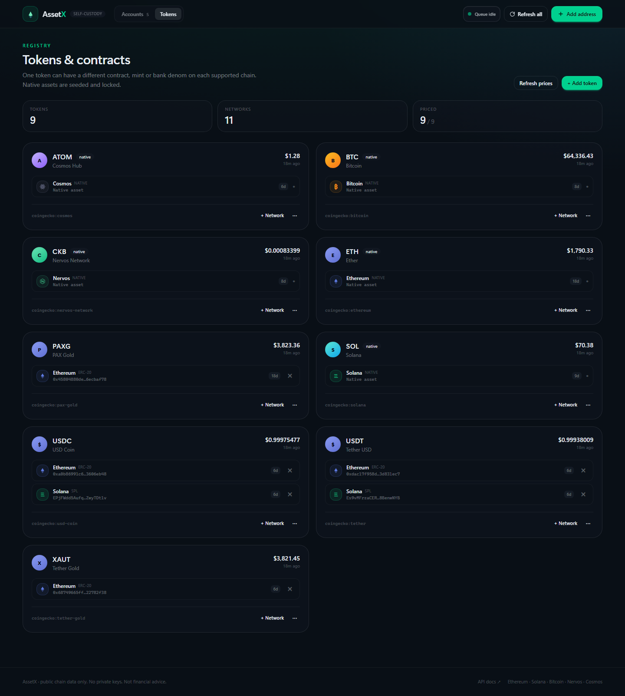
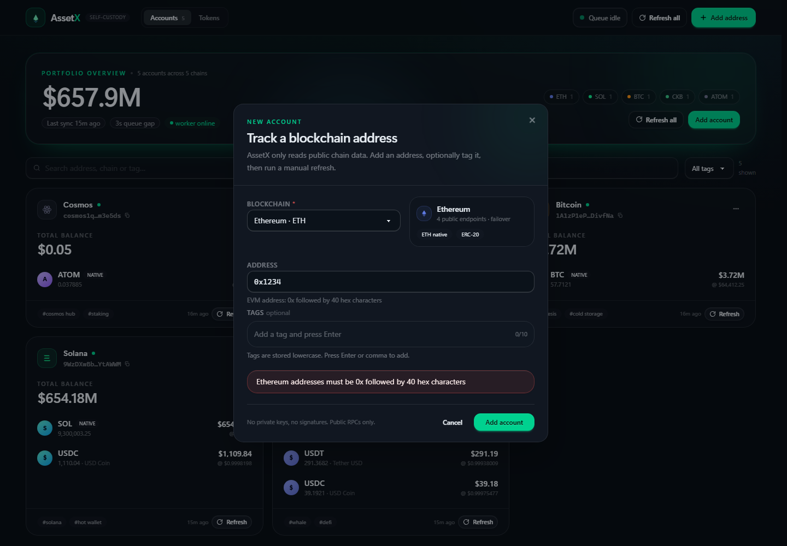
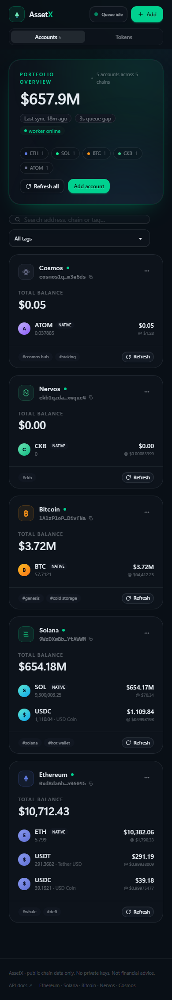

# AssetX documentation

AssetX is a local-first multi-chain portfolio tracker. This directory documents the product behavior, the backend design, the HTTP API, chain integration details, and the development workflow.

## Contents

| Document | What it covers |
| --- | --- |
| [Architecture](architecture.md) | Layers, SQLite schema, refresh pipeline, queue, RPC failover, price cache |
| [API reference](api.md) | Every endpoint, request/response shapes, errors, curl examples |
| [Chains & RPCs](chains.md) | Supported chains, native tokens, token standards, public endpoints, limitations |
| [Development](development.md) | Setup, run, test, build, configuration, project layout, extension points |

## Product rules

1. An address belongs to exactly one of **Ethereum**, **Solana**, **Bitcoin**, **Nervos**, **Cosmos**, or **Stacks**, selected from a dropdown.
2. Tags are optional, trimmed, de-duplicated, and always stored lowercase.
3. Every chain has a native token: ETH, SOL, BTC, CKB, ATOM, STX.
4. The token registry ships with ETH, SOL, BTC, CKB, ATOM, STX, SBTC, USDT, USDC, PAXG, and XAUT. A token can have a different contract/mint/denom/asset id per chain.
5. Refreshes are manual. A queue processes one address at a time with at least **3 seconds between address starts**.
6. On a successful refresh AssetX writes the latest balance rows, the USD price/value, the endpoint that answered, and the address/chain refresh timestamp.
7. If a public endpoint fails, the next endpoint for that chain is tried in order.
8. Home is an account-card grid. Each card shows up to three assets, the total USD value, tags, refresh state, and a per-card refresh button.

## Screenshots

| Accounts | Tokens |
| --- | --- |
|  |  |

| Add address | Mobile |
| --- | --- |
|  |  |

## Quick links

- API docs at runtime: `http://127.0.0.1:8000/api/docs`
- Health check: `GET /api/health`
- Frontend source: `frontend/src`
- Backend source: `backend/app`
- Tests: `backend/tests`
